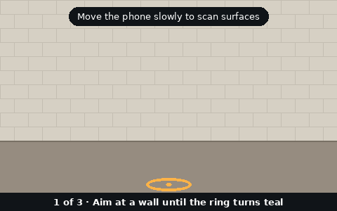

# Camera Planner

A static website for planning a home CCTV setup in three paginated steps — **1. Draw my house**, **2. Camera & blind spots**, and **3. Costs** (with an option to auto-populate from your 2D floor plan) — plus a separate **What's coming** page with **Sneak peek** buttons for the standalone **Camera Primer** (`primer.html`) and **3D (AR) Wall Visualizer** (`google-ar/wall-cameras-ar.html`).



## Features

- **Step 1 — Draw my house (2D):** start with the interactive example floor plan. Clicking **Try out your floor plan** or **Your plan** opens the custom floor-plan canvas and automatically advances you to **Step 2: Camera & blind spots**.
- **Step 2 — Camera & blind spots (2D):** draw walls and room labels, place indoor and outdoor cameras on your floor plan, aim cameras, adjust field-of-view and range sliders, and view coverage cones to spot blind spots.
- **Suggest cameras (2D, experimental):** after you draw your walls, the **Suggest** tool proposes camera positions at the corners of your plan. Suggestions are a starting point and can be wrong, so check each one.
  1. Tap **Suggest**. Each closed area shows "In or out?". Tap **In** or **Out** to mark it. To mark the outside, tap an empty spot outside the walls, then **Out**. Tap an area's label again to change it (In, Out, then unmarked).
  2. Dashed cameras appear at wall corners. Tap one to place it, or use **Place all**. One **Undo** reverts a whole Place all.
  - **Indoor cameras** go in inner corners only, with **at most 3 per closed space**. When a space has more corners than that, the 3 that cover the most floor are kept, so a rectangular room never gets all 4 corners.
  - **Outdoor cameras** go at outer corners. Every area marked **Out** always gets **at least 1** suggested outdoor camera, even when the camera cart has none left.
  - **Camera cart:** if you have added cameras on the main page, suggestions are limited to what is left of your cart (indoor and outdoor counted separately), apart from the one-outdoor-camera minimum above. With an empty cart there is no limit.
  - **Open areas:** an area that is not closed (for example a doorway left as a gap) is flagged with ⚠. Close the gap with a line, or keep it as marked.
  - **Clear marks** removes all In/Out marks. If you change the walls afterwards, marks that no longer sit in an area are reported and can be cleared the same way.
  - **Limits:** coverage cones still pass through walls, areas must be closed to be detected, and there are no dome, bullet or turret types in the 2D tool, only indoor and outdoor.
- **Step 3 — Cost estimation:** budget slider and text input; choose HD camera + DVR or IP camera + NVR; mix wired and WiFi dome, bullet, and turret cameras; or click **Auto-populate from 2D plan** to seed the cart from your Step 2 camera placements. The cost table updates live and stops you adding cameras that would exceed the budget or the recorder limit (4 for DVR, 7 for NVR). In the cart, each camera row has **−** and **+** buttons (**+** obeys the same budget and recorder limits), a trash icon to remove the whole entry, and a **Clear cart** button that empties every cart after you confirm.
- **What's coming (Separate Page with Sneak Peek buttons):** opened from the top navigation bar or the **What's coming →** pagination button at the bottom of Step 3 (hiding the Costs page while open):
  - **Know your camera (`primer.html`):** a standalone, plain-language visual guide where every section opens and closes with a chevron explaining camera types (including indoor and PTZ), DVR vs NVR, connection types, and terms used in the form.
  - **3D (AR) Wall Visualizer (`google-ar/wall-cameras-ar.html`):** opens the WebXR page, where you mount cameras on a real wall through your phone camera. Its start screen has a **Back to planner** link.
- **Additional information (`additional-info.html`):** opened from the Camera Primer (`primer.html`) or cost notes, covering IP and IK ratings, India's STQC rule, STQC-certified brands, storage sizing, H.265+ encoding, battery cameras, SIM and SD card options, phone and web viewing, ONVIF and RTSP, alarms and image recognition, privacy and safety, and DORI with a calculator link.

## Files

| File | Purpose |
| --- | --- |
| `index.html` | Main paginated planner: Step 1 (Draw my house), Step 2 (Camera & blind spots), Step 3 (Costs), and separate Step 4 (What's coming) |
| `flat_camera_coverage_floor_plan.html` | 2D floor plan, coverage tool, and experimental camera suggestions (loaded inside `index.html` with auto-navigation to Step 2 when entering Your plan) |
| `primer.html` | Standalone "Know your camera" visual primer page (linked via Sneak peek in What's coming) |
| `additional-info.html` | Extra buying and setup information, opened from `primer.html` and cost notes |
| `google-ar/wall-cameras-ar.html` | 3D AR wall-camera tool (linked via Sneak peek in What's coming) |
| `google-ar/ar-intro.gif` | 3D start screen animation above the Start AR button: scan, mount, adjust |
| `google-ar/ar-walkthrough.gif` | Shown in the 3D page's Walkthrough panel: scan, mount, and what pan, tilt and view angle mean |
| `google-ar/ar-style.gif` | Shown in the 3D page's Walkthrough panel: range, opacity and color |
| `.gitignore` | Ignores `*.json`, such as downloaded plan files |

Keep this folder layout, because `index.html` links to the other pages by relative path.

## Run locally

There is no build step. Serve the folder over HTTP, for example:

```
python3 -m http.server 8000
```

Then open `http://localhost:8000/`.

## Deploy

Upload all files, with the same structure, to any static host that serves **HTTPS**. The 3D view needs HTTPS, plus Chrome on an Android phone with Google Play Services for AR (ARCore).

## Pricing

All prices are approximate and exclude GST. Most come from the project owner's price list; the DVR bullet and turret prices are web estimates. WiFi camera prices (3 MP dome ₹2,500, 2 MP IR bullet ₹2,800, 4 MP turret ₹4,500) were also supplied by the project owner. Every price can be edited in the "Edit price list" section, which lists only the cameras you have added unless you choose to show them all.

## Data and privacy

No accounts, analytics or tracking, and nothing entered is sent to a server. Budget, cameras, prices and floor plans are saved only in the visitor's browser (local storage). Floor plans include the In/Out area marks used by Suggest; saved plan files use format version 2, and older version 1 files still load. Camera suggestions are calculated on the device with plain JavaScript, and the 2D tool reads the camera cart from the same local storage to limit them. The 3D page uses the device camera and motion sensors locally and loads three.js from the jsDelivr CDN.

## Author

Made by Sourabh · [Portfolio](https://sourabhkumarsingh-portfolio.lovable.app/)