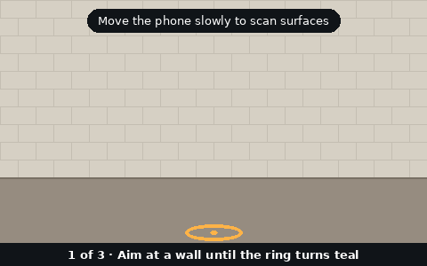

# Camera Planner

A static website for planning a home CCTV setup: set a budget, mix camera types, get an approximate cost, then visualize coverage in 2D or in AR.



## Features

- **Cost estimation:** budget slider and text input; choose HD camera + DVR or IP camera + NVR; wired, wired and WiFi cameras can be mixed in one estimate; add dome, bullet and turret cameras in any mix. The cost table updates live and stops you adding cameras that would exceed the budget or the recorder limit (4 for DVR, 7 for NVR).
- **Visualize (2D):** the floor-plan coverage tool is embedded in the main page. Draw walls, place indoor and outdoor cameras and see their coverage cones.
- **Visualize (3D):** opens the WebXR page, where you mount cameras on a real wall through your phone camera.
- **Know your camera:** a collapsed, plain-language infographic where every point opens and closes with a chevron explaining camera types (including indoor and PTZ), DVR vs NVR, connection types and the terms used in the form. It is built from plain HTML and CSS and only added to the page when opened, so it does not slow the page load.
- **Additional information:** a separate page (`additional-info.html`) with IP and IK ratings, India's STQC rule, STQC-certified brands, storage sizing, H.265+ encoding, battery cameras, SIM and SD card options, phone and web viewing, ONVIF and RTSP, alarms and image recognition, privacy and safety, and DORI with a calculator link.
- The cost estimate is optional. You can go straight to Visualize.

## Files

| File | Purpose |
| --- | --- |
| `index.html` | Main page: budget, camera cart, cost estimate, embedded 2D plan, footer |
| `additional-info.html` | Extra buying and setup information, opened from the "Know your camera" guide |
| `flat_camera_coverage_floor_plan.html` | 2D floor plan and coverage tool (loaded inside `index.html`) |
| `google-ar/wall-cameras-ar.html` | 3D AR wall-camera tool (opened as a separate page) |
| `google-ar/ar-intro.gif` | 3D start screen animation above the Start AR button: scan, mount, adjust (replace any of the GIFs with your own recording if you like) |
| `google-ar/ar-walkthrough.gif` | Shown in the 3D page's Walkthrough panel: scan, mount, and what pan, tilt and view angle mean |
| `google-ar/ar-style.gif` | Shown in the 3D page's Walkthrough panel: range, opacity and color |
| `.gitignore` | Ignores `*.json`, such as downloaded plan files |

Keep this folder layout, because `index.html` links to the other pages by relative path.

## Run locally

There is no build step. Serve the folder over HTTP, for example:

```
python3 -m http.server 8000
```

Then open `http://localhost:8000/`.

## Deploy

Upload all files, with the same structure, to any static host that serves **HTTPS**. The 3D view needs HTTPS, plus Chrome on an Android phone with Google Play Services for AR (ARCore).

## Pricing

All prices are approximate and exclude GST. Most come from the project owner's price list; the DVR bullet and turret prices are web estimates. WiFi camera prices (3 MP dome ₹2,500, 2 MP IR bullet ₹2,800, 4 MP turret ₹4,500) were also supplied by the project owner. Every price can be edited in the "Edit price list" section, which lists only the cameras you have added unless you choose to show them all.

## Data and privacy

No accounts, analytics or tracking, and nothing entered is sent to a server. Budget, cameras, prices and floor plans are saved only in the visitor's browser (local storage). The 3D page uses the device camera and motion sensors locally and loads three.js from the jsDelivr CDN.

## Author

Made by Sourabh · [Portfolio](https://sourabhkumarsingh-portfolio.lovable.app/)